  <picture>
    <source media="(max-width: 600px)" srcset="./assets/profile/hero-mobile.svg" />
    
  </picture>

  <a href="https://github.com/Alok-Yadav25?tab=repositories">Explore my work</a> &nbsp; / &nbsp;
  <a href="https://linkedin.com/in/AlokYadav2500">LinkedIn</a> &nbsp; / &nbsp;
  <a href="mailto:ay252003@gmail.com">Get in touch</a>

 

### A little context

I build **AI-powered products from model to interface** — connecting machine learning, reliable APIs, and carefully designed experiences. My work spans code intelligence, observability, computer vision, and privacy tooling.

Currently building **[Pulse](https://github.com/Alok-Yadav25/Pulse)** and **[DevPilot](https://github.com/Alok-Yadav25/DevPilot)**. Going deeper into LLM evaluation, RAG, and production AI systems. Open to **AI/ML engineering opportunities** and ambitious technical collaborations.

 

### Selected work

Four projects at the intersection of useful intelligence and product craft. Each card opens the source.

  
  
   
  
  

  <a href="https://devpilot-alokyadav25.pages.dev">Try DevPilot ↗</a> &nbsp; · &nbsp;
  <a href="https://veil-20l2.onrender.com">Explore VEIL ↗</a> &nbsp; · &nbsp;
  <a href="https://github.com/Alok-Yadav25?tab=repositories">All repositories ↗</a>

  
<strong>More experiments & earlier work</strong>

   

  | Project | Exploration |
  | :--- | :--- |
  | [Suraksha Setu](https://github.com/Alok-Yadav25/Fake-bank-apk-detection) | Suspicious banking APK detection using static analysis and machine learning. |
  | [Stock Price Predictor](https://github.com/Alok-Yadav25/Stock-prediction-using-LSTM) | Time-series forecasting with LSTMs and market data. |
  | [Lane Detection](https://github.com/Alok-Yadav25/lane-detection-cv) | Computer vision for road lane identification in images and video. |
  | [Stocky](https://github.com/Alok-Yadav25/Stocky) | A modern market intelligence dashboard for stocks, charts, and portfolios. |

 

### Open source contributions

Active contributor to production machine learning libraries, developer tooling, and algorithmic foundations:

| Repository | Domain | Contribution | Status |
| :--- | :--- | :--- | :--- |
| **[scikit-learn/scikit-learn](https://github.com/scikit-learn/scikit-learn)** | ML / Core | Fixed non-numeric array attributes handling in `move_estimator_to` ([#35481](https://github.com/scikit-learn/scikit-learn/pull/35481)) | `Open` · CI Passing |
| **[TheAlgorithms/Python](https://github.com/TheAlgorithms/Python)** | Algorithms / Math | Implemented Woodall numbers generation & primality testing ([#15777](https://github.com/TheAlgorithms/Python/pull/15777)) | `Open` · Tests Passing |
| **[mvanhorn/last30days-skill](https://github.com/mvanhorn/last30days-skill)** | AI Agents / LangGraph | Added LinkedIn to planner source capabilities for `how_to` intent ([#1545](https://github.com/mvanhorn/last30days-skill/pull/1545)) | `Merged` 🎉 |
| **[JabRef/jabref](https://github.com/JabRef/jabref)** | Java / Tooling | Added syntax error warning dialog on bibliographic data import ([#17881](https://github.com/JabRef/jabref/pull/17881)) | `Open` · All Checks Passing |
| **[freeCodeCamp](https://github.com/freeCodeCamp/freeCodeCamp)** | Web Curriculum | Curriculum typo fix & maintainer triage ([#71751](https://github.com/freeCodeCamp/freeCodeCamp/issues/71751), [#71752](https://github.com/freeCodeCamp/freeCodeCamp/pull/71752)) | `Triaged` |
| **[sudheerj/reactjs-interview-questions](https://github.com/sudheerj/reactjs-interview-questions)** | React / Docs | Documented question numbering mismatch and duplicate entries ([#416](https://github.com/sudheerj/reactjs-interview-questions/issues/416)) | `Open` |

 

### Tools of the trade

<picture>
  <source media="(max-width: 600px)" srcset="./assets/profile/toolkit-mobile.svg" />
  
</picture>

 

### Small steps, compounding

A year of building, rendered as an isometric skyline. Every block represents a day; its height reflects real contributions.

Refreshed daily with GitHub Actions · Custom SVGs · Motion respects reduced-motion preferences

 

  <a href="mailto:ay252003@gmail.com">ay252003@gmail.com</a> &nbsp; / &nbsp;
  <a href="https://linkedin.com/in/AlokYadav2500">Let's connect on LinkedIn ↗</a>

